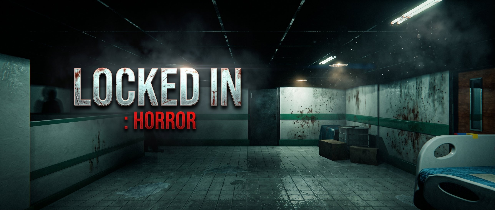
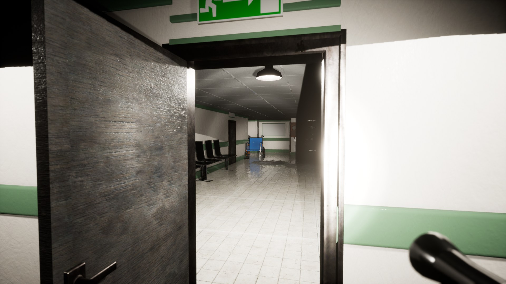
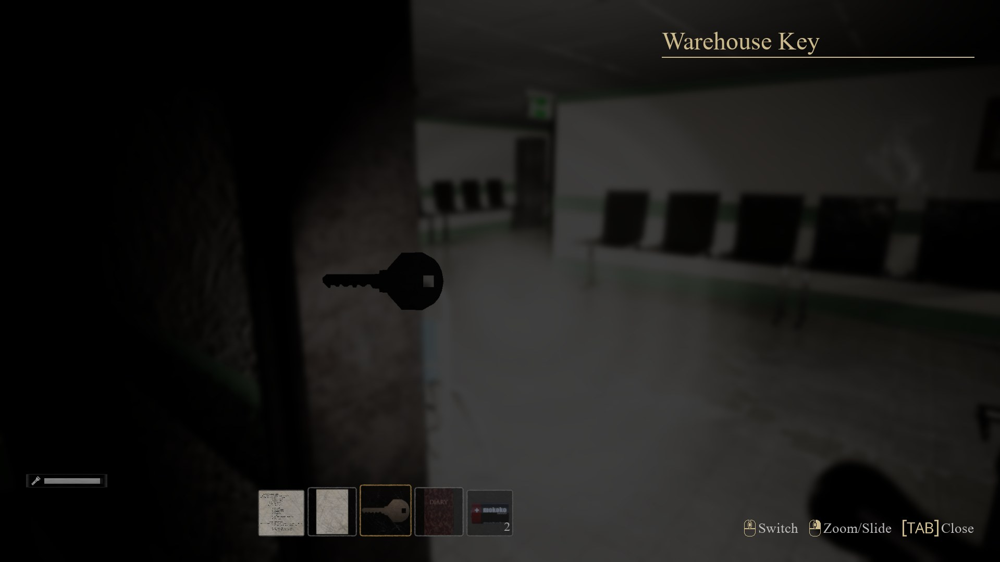
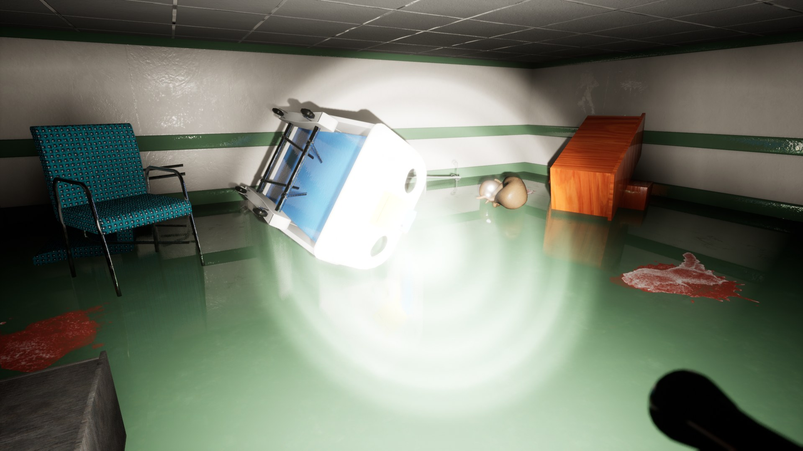
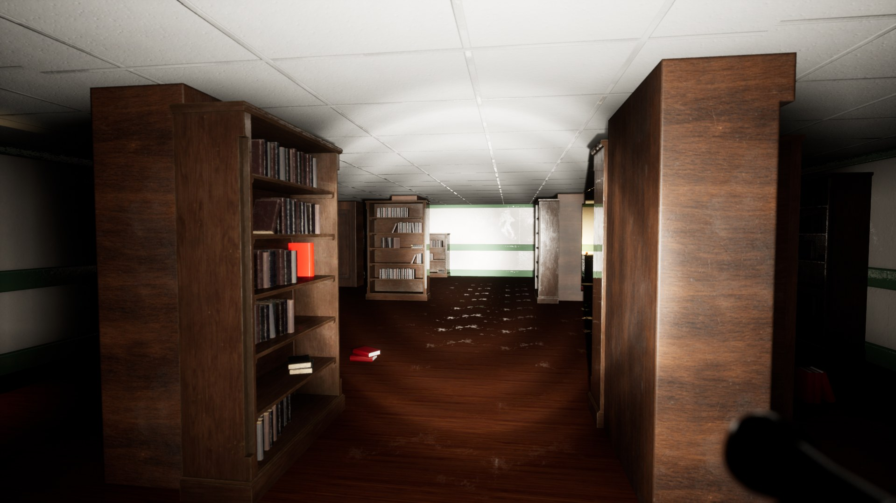
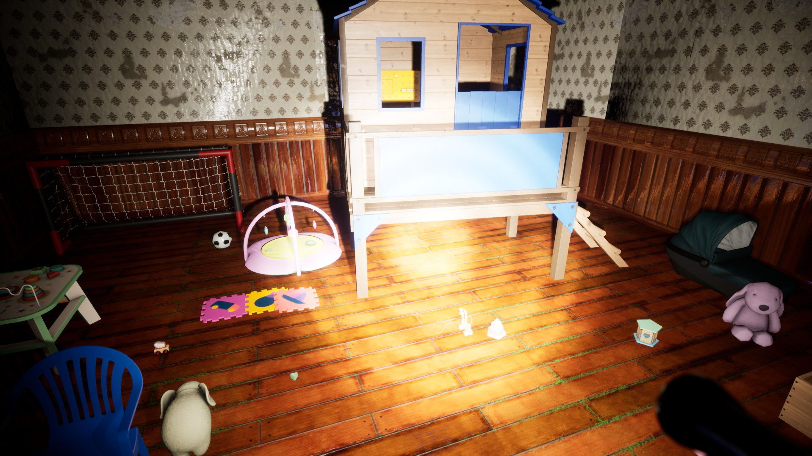
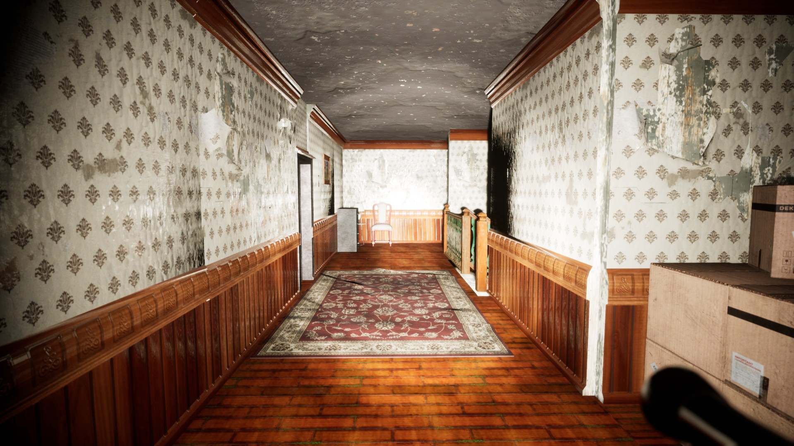

  

# 👁️ Locked In: Horror

**A first-person horror game built with Unreal Engine 4.27**  
Explore, find keys, manage your flashlight batteries and survive.

> **Play it:** [Locked In: Horror on itch.io](TODO_ITCH_LINK) · [Latest release](TODO_RELEASE_LINK)
>
> This repository is a showcase. The Unreal project files are not published, see [About this repository](#-about-this-repository).

---

## 📸 Screenshots

|  **Hospital wing**: open a door and light the way |  **Inventory**: keys, notes, a diary and batteries |
| --- | --- |
|  **Flooded room**: something went wrong here |  **Library**: shelves to hide behind |
|  **Kids room**: toys left behind |  **Mansion hallway**: peeling wallpaper, creaking floor |

---------------------------------------- | ---------------------------------------- |
|  |  |
|  |  |

---

## 🚀 Features

- 🔦 **Flashlight with limited battery**: when the charge runs out, you have to find and swap in new batteries
- 🔋 **Battery pickups** scattered around the map
- 🚪 **Interactive doors**: open them with a click, locked doors need the right key
- 🎒 **Inventory system**: collect items, select a key from the inventory to unlock a door
- 👀 **Peek and lean**: look around corners without exposing yourself
- 🧎 **Crouch** to move quietly and fit into tight spaces
- 🔍 **Zoom** to inspect details from a distance

## 🎮 Controls

| Action                      | Input                   |
| --------------------------- | ----------------------- |
| Move                        | `W` `A` `S` `D`         |
| Look around                 | Mouse                   |
| Zoom                        | Mouse wheel (press)     |
| Crouch                      | `Ctrl`                  |
| Peek left / right           | `Q` / `E`               |
| Open / close inventory      | `Tab`                   |
| Open door / interact        | Left mouse button       |
| Use item (e.g. key)         | Select it in inventory  |

> **Locked doors:** click the door, open your inventory with `Tab`, then select the key to unlock it.

## 📥 Download

Grab the Windows build from **[itch.io](TODO_ITCH_LINK)** or the **[Releases page](TODO_RELEASE_LINK)**.

1. Download the `.zip` file.
2. Extract it to any folder.
3. Run the `.exe` file.

**System requirements (recommended)**

| Component | Requirement                                   |
| --------- | --------------------------------------------- |
| OS        | Windows 10 / 11, 64-bit                       |
| CPU       | Mid-range quad-core or better                 |
| GPU       | Mid-range dedicated GPU, DirectX 11 capable   |
| RAM       | 16 GB                                         |
| Storage   | 6 GB free space                       |

If the game does not start, install the latest [Visual C++ Redistributable](https://learn.microsoft.com/cpp/windows/latest-supported-vc-redist).

## 🏗️ Tech Stack

| Category | Technology              |
| -------- | ----------------------- |
| Engine   | Unreal Engine 4.27      |
| Platform | Windows (64-bit)        |

## 🙏 Credits

Game design and gameplay scripting: **kaandevs-ops**. Core systems such as the inventory, flashlight and interaction are based on the **Horror Engine** asset pack and were customized and extended for this game.

The 3D models, textures and sounds come from third-party asset packs (Unreal Engine Marketplace / Fab and others). They belong to their respective authors, are used under their own licenses and are not included in this repository.

## 📖 About this repository

The source project is not published because it relies on licensed third-party assets (models, textures, sounds) that cannot be redistributed. This repository contains the README, screenshots and links to the playable build.

## 📄 License

Copyright 2026 kaandevs-ops

All rights reserved for the game's original content (design and custom scripting). Third-party assets belong to their respective authors and are used under their own licenses.

---

*Still learning, still shipping.*

